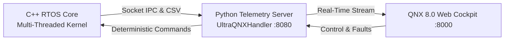

# 🚗 QNX 8.0 Deterministic Sensor Fusion & Autonomous Safety Cockpit

A real-time, deterministic automotive cockpit and microkernel simulation built with **C++ (Multi-Threaded RTOS Core)**, **Python (Socket IPC & Telemetry Bridge)**, and an **Interactive 4-Layer Web Cockpit**.

---

## 🏗️ System Architecture



---

## ⚡ Key Advanced Features

1. **Deterministic C++ Microkernel Core & Socket IPC**
   * Sub-10µs deterministic latency monitoring with live **RTOS Jitter Oscilloscope**.
   * Multi-mode driving profiles (**ECO**, **SPORT**, **EMERGENCY BRAKE**) and live **Sensor Fusion** (LiDAR, Radar, ADAS Sonar).
2. **QNX Adaptive Partitioning (APS) & HAM Self-Healing**
   * Dynamic CPU budget allocation: guarantees **90% locked CPU priority (`Prio 9u`)** to safety-critical tasks during faults while throttling non-critical infotainment.
   * **High Availability Manager (HAM)** automatic failover recovery in `~11.4ms` with downloadable **Blackbox CSV** flight recorder.
3. **Level-4 Autonomous AEB & 3D Digital Twin**
   * **Autonomous Emergency Braking (AEB)** triggered automatically upon radar obstacle detection (`3.2ms` brake lock).
   * Interactive **3D Wireframe Digital Twin**, **Live Kernel Ring Buffer Console**, and **AI Voice Co-Pilot** audio alerts.
4. **QNX Hypervisor Cyber-Shield & Zero-Downtime OTA**
   * **Crypto-CAN Intrusion Detection System (IDS)** isolating spoofed CAN frames (`HMAC-SHA256`) inside a hypervisor sandbox.
   * **A/B Memory Bank OTA Manager** applying live firmware security patches with `0ms` system downtime.
   * **5.9GHz DSRC V2X Emergency Broadcast** transmitting Basic Safety Messages (BSM) during critical events.

---

## 🚀 Quick Start (Codespaces / Linux)

```bash
# 1. Compile and start the C++ RTOS Core
g++ -pthread qnx_rtos_core.cpp -o qnx_rtos_core && ./qnx_rtos_core &

# 2. Start the Python IPC Server (Port 8080) and Web Cockpit (Port 8000)
python3 qnx_vehicle_server.py &
python3 -m http.server 8000 &
```
